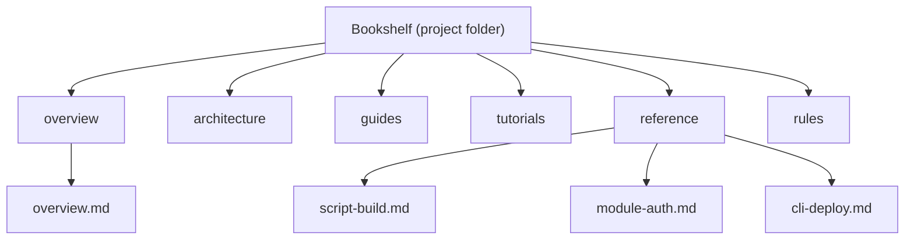

# Agent Documentation Guide — Documenting a Project into the Bookshelf

You are an AI coding agent (Claude Code CLI) opened on a target project. Your job is to
**document that project completely** and publish it into the orchestration system's
**bookshelf** — a structured Google Drive library that humans and other agents read.

This is the authoritative reference. Read it fully before you start. Follow it exactly.

## The bookshelf mental model

Think of the published documentation as a physical bookshelf:

- The **project folder** in Drive is the *shelf* — one shelf per project.
- The shelf is divided into **6 fixed sections (categories)**: `overview`, `architecture`,
  `guides`, `tutorials`, `reference`, `rules`.
- Each Markdown file you upload is a **book** that sits in exactly one section.



A good shelf lets a newcomer go from "never heard of this project" to "productive
contributor" without reading the source code. Every script, module, command, endpoint,
and feature has a place on the shelf.

## What belongs in each category

Put every book in the **right** section. Mis-filing is the most common failure.

### overview

The "back cover" of the project. One to a few books.

- What the project is and **why** it exists (the problem it solves).
- Value proposition — who it's for, what it gives them.
- A **quickstart**: the shortest path to seeing it work.
- Project status — maturity, version, what's done vs. planned.

### architecture

How the system is built. Diagrams strongly encouraged.

- System design and the major components, and how they fit together.
- **Data flow** — how a request/job/event moves through the system.
- Tech stack and why each piece was chosen.
- **Mermaid diagrams** (component, sequence, ER, flow) — at least one.
- Key design decisions and trade-offs (an informal ADR log is ideal).

### guides

Task-oriented **how-tos**. Each book answers "how do I _do X_?"

- Setup / install / local development.
- Deploy, configure, integrate with other systems.
- Operational runbooks (back up, migrate, rotate keys, troubleshoot).
- Goal-focused and assumes some familiarity. Contrast with tutorials.

### tutorials

Step-by-step **walkthroughs for newcomers**, end-to-end.

- Take a beginner from zero to a working result in order, no skipped steps.
- Narrative and teaching-oriented ("now you will…"), not just reference.
- Example: "Build and run your first feature against this project."

### reference

**EXHAUSTIVE.** This is where completeness is mandatory.

- **One book per script**, per module/package, per CLI command, per API endpoint,
  per configurable feature.
- Document **every** script and **every** feature found in the repo — no omissions.
- For each item: purpose, inputs/arguments/flags, outputs/returns, side effects,
  configuration, env vars, error modes, and a usage example.
- Reference is dry and complete; correctness and coverage matter more than prose.

### rules

The project's **conventions and constraints**.

- Coding standards, naming, formatting, lint/test commands.
- Architectural constraints and invariants that must not be broken.
- **Gotchas** and footguns discovered in the code.
- Clear **do / don't** lists. If the repo has a `CLAUDE.md`, `CONTRIBUTING.md`, or
  `.editorconfig`, distil their rules here.

## Markdown standards

Every book must follow these standards so the library renders and links consistently.

### YAML frontmatter (required on every file)

```yaml
---
type: reference        # reference | guide | tutorial | overview | architecture | rules
category: reference    # the bookshelf category this file is filed under
title: build.sh — Build Script
version: 1.0
source_path: scripts/build.sh   # repo-relative path this doc describes (if applicable)
---
```

`category` in the frontmatter MUST match the `category` you pass to the API for that file.

### Body rules

- **Strict ATX headers**: `#`, `##`, `###` with a space after the hashes. Exactly one
  `#` H1 per file, matching the title. Don't skip levels.
- **Fenced code blocks with a language**: ` ```bash `, ` ```python `, ` ```json ` —
  never a bare ` ``` `.
- **Mermaid for diagrams**: ` ```mermaid ` fenced blocks. Don't paste ASCII art.
- **Relative links between books** within the shelf, e.g.
  `[the auth module](../reference/module-auth.md)`.
- Tables for structured data (flags, env vars, endpoints).
- Keep one idea per file; prefer several focused books over one giant book.

## Completeness mandate

Documentation is **complete** only when it covers the *whole* repo. Process:

1. **Enumerate the repo first.** List every script, module/package, CLI command, API
   endpoint, config file, and user-facing feature. Use the file tree, `package.json` /
   `pyproject.toml` / `Makefile` / CI config, and entrypoints to find them all.
2. **Map each item to a category** (most land in `reference`).
3. **Write a book for every item.** Every script and every feature gets a `reference`
   doc. No "etc.", no "and similar files" — enumerate and cover each one.
4. **Cross-link**: from `overview`/`guides`/`tutorials`, link to the relevant `reference`
   and `architecture` books.
5. **Self-audit** against the checklist below before finishing.

If the repo has 14 scripts, the shelf has at least 14 `reference` books. Treat anything
in the folder as in-scope.

## The API workflow

Base URL (`{{BASE_URL}}`): `https://edts025131.iguana-wezen.ts.net/api/v1` over the
tailnet, or `http://127.0.0.1:8000/api/v1` locally.

You will: register/obtain an agent key → create the project → **provision the bookshelf**
→ check in → **POST one document per book with its category** → **verify via the
library**. The `document` endpoint does NOT change session state, so call it as many
times as you have books.

### Step 1 — Obtain an agent (once)

```bash
curl -sX POST "{{BASE_URL}}/agents" \
  -H 'Content-Type: application/json' \
  -d '{"name":"docs-agent"}'
# → {"id":"<AGENT_ID>","api_key":"<AGENT_KEY>"}   # api_key shown ONCE — save it
```

### Step 2 — Create the project

`gdrive_folder_id` is the **parent** Drive folder; the bookshelf is created *under* it,
named after the project.

```bash
curl -sX POST "{{BASE_URL}}/projects" \
  -H 'Content-Type: application/json' \
  -d '{"name":"<PROJECT_NAME>","gdrive_folder_id":"<FOLDER_ID>","description":"<one-liner>"}'
# → {"id":"<PROJECT_ID>", ...}
```

### Step 3 — Provision the bookshelf

Creates the `<PROJECT_NAME>` folder plus the 6 category subfolders.

```bash
curl -sX POST "{{BASE_URL}}/projects/<PROJECT_ID>/bookshelf"
# → {"id":"<PROJECT_ID>","bookshelf_folder_id":"<SHELF_ID>", ...}
```

### Step 4 — Check in

```bash
curl -sX POST "{{BASE_URL}}/agents/checkin" \
  -H 'Content-Type: application/json' \
  -H 'X-Agent-Key: <AGENT_KEY>' \
  -d '{"agent_id":"<AGENT_ID>","project_id":"<PROJECT_ID>"}'
# → {"session_id":"<SESSION_ID>", ...}
```

### Step 5 — Upload each book (repeat per file)

`category` must be one of `overview|architecture|guides|tutorials|reference|rules` and
match the file's frontmatter `category`.

```bash
curl -sX POST "{{BASE_URL}}/sessions/<SESSION_ID>/document" \
  -H 'Content-Type: application/json' \
  -H 'X-Agent-Key: <AGENT_KEY>' \
  -d '{
        "agent_id":"<AGENT_ID>",
        "category":"reference",
        "file_name":"build-sh.md",
        "content":"---\ntype: reference\ncategory: reference\ntitle: build.sh\nversion: 1.0\nsource_path: scripts/build.sh\n---\n\n# build.sh\n\n...",
        "commit_message":"Document build.sh"
      }'
# → 201 Created
```

Send larger payloads from a file to avoid quoting pain:

```bash
jq -n --arg c "$(cat book.md)" \
  '{agent_id:"<AGENT_ID>",category:"reference",file_name:"build-sh.md",content:$c,commit_message:"Document build.sh"}' \
| curl -sX POST "{{BASE_URL}}/sessions/<SESSION_ID>/document" \
    -H 'Content-Type: application/json' -H 'X-Agent-Key: <AGENT_KEY>' -d @-
```

### Step 6 — Verify via the library

```bash
curl -sX GET "{{BASE_URL}}/projects/<PROJECT_ID>/library"
# → { project_id, bookshelf_folder_id, sections:[{category, documents:[...]}] }
```

Read any book back with `GET {{BASE_URL}}/artifacts/<gdrive_file_id>`.

### Using the SDK instead of curl

The stdlib-only SDK in `packages/agent-sdk` wraps every call:

```python
from orchestrator_sdk import AdminClient, AgentClient, markdown_document

admin = AdminClient(BASE_URL)
reg = admin.register_agent("docs-agent")
agent = AgentClient(BASE_URL, reg["id"], reg["api_key"])

project = admin.create_project(PROJECT_NAME, gdrive_folder_id=FOLDER_ID)
admin.provision_bookshelf(project["id"])
sid = agent.check_in(project["id"])["session_id"]

book = markdown_document(
    "build.sh",
    {"type": "reference", "category": "reference", "version": "1.0",
     "source_path": "scripts/build.sh"},
    "## Purpose\n\nBuilds the project.\n",
)
agent.document(sid, "reference", "build-sh.md", book, "Document build.sh")

library = admin.list_library(project["id"])
```

See `examples/document_to_bookshelf.py` for a complete runnable reference.

## Quality bar — definition of "complete documentation"

Do not stop until every box is checked.

- [ ] The bookshelf was provisioned and all 6 categories exist.
- [ ] **overview** explains what/why, value, a working quickstart, and status.
- [ ] **architecture** has the component breakdown, data flow, tech stack, key
      decisions, and at least one Mermaid diagram.
- [ ] **guides** cover setup and every major operational task (deploy/configure/integrate).
- [ ] **tutorials** include at least one end-to-end newcomer walkthrough.
- [ ] **reference** has **one book per** script, module, CLI command, API endpoint, and
      feature — the whole repo is enumerated and covered, nothing omitted.
- [ ] **rules** capture conventions, standards, constraints, gotchas, and do/don't lists.
- [ ] Every file has valid YAML frontmatter; `category` frontmatter == API category.
- [ ] Strict ATX headers, fenced code blocks all carry a language, diagrams use Mermaid.
- [ ] Books cross-link with relative paths.
- [ ] `GET /projects/{id}/library` lists every book under the expected category.
- [ ] A newcomer could become productive from the shelf alone, without the source.
